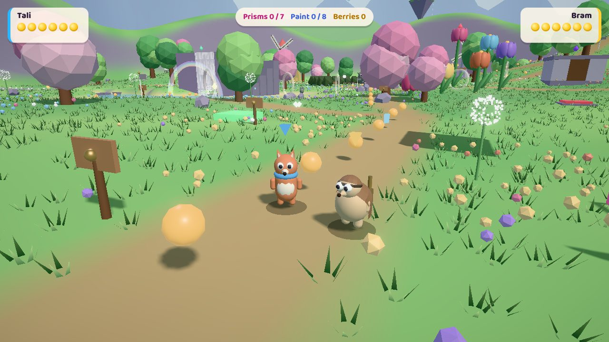
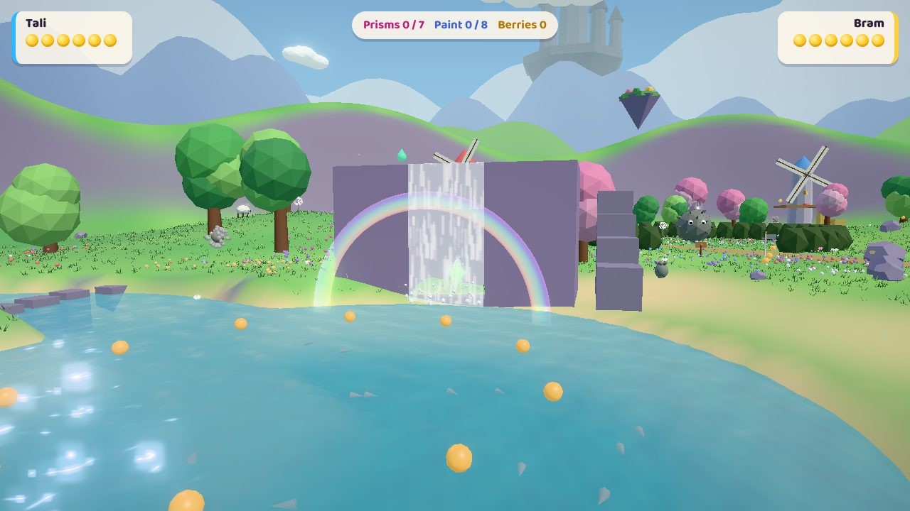

# JumpAI

A two-player co-op 3D platformer. Two heroes, Tali the fox courier and Bram the pangolin tinkerer, win back the Prisms that keep the world colourful after a villain called the Hush drained it grey.

This repository holds the first playable build: **World 1, Bloomvale Meadow**. It covers the spec's first two milestones, the movement prototype and the World 1 vertical slice. It runs in the browser on Three.js.



## Play it

```bash
npm install
```

```bash
npm run dev
```

Open the URL Vite prints, then press **1** for solo or **2** for couch co-op. Gamepads work too (standard mapping; pad 1 is Tali, pad 2 is Bram).

| Action | Tali (P1) | Bram (P2) | Gamepad |
| --- | --- | --- | --- |
| Move | W A S D | Arrow keys | Left stick |
| Jump | Space | Enter | A |
| Crouch / ground pound | Left Shift or C | Right Shift | B |
| Punch / dive | F | / | X |
| Grab / Toss partner | G | . | Y |
| Camera | Q / E or drag the mouse | [ / ] | Right stick |

Esc pauses and M toggles the music. The title screen has an assist mode that halves damage.

## What's in this build

**Movement.** Analog, momentum-based 3D platforming, tuned to the spec's numbers:

- single, double and triple jump chain
- backflip, side flip and long jump
- wall kick, ground pound and dive with belly-slide rollout
- crouch slide, ledge grab and climb
- swimming with an air supply
- coyote time, jump buffering, variable jump height and fall damage
- Tali's Scarf Glide, and Bram's Curl Roll, which breaks cracked walls

**Co-op.**

- Boost Jump off your partner's head
- grab and Toss your partner, aimed with the stick
- Twin Pound: two ground pounds at once make a shockwave
- Revive Bubbles: a downed partner floats over, and you jump into the bubble to pop it
- shared camera that splits the screen when the heroes are more than 25 m apart

**Bloomvale Meadow.** The meadow has 7 Prisms, each a different kind of challenge:

| Prism | Challenge |
| --- | --- |
| Summit of Bloomvale | Climb the summit tower: crumbling platforms, a spring pad, then a backflip |
| Thistlequeen's Thorny Crown | Boss fight: dodge thorn volleys, then pound her crown while she is dizzy. Phase 3 needs a Toss in co-op |
| Three Bells, One Vault | Ground pound the bell button on each of 3 windmills to open the vault |
| Two Plates, One Gate | Hold both pressure plates down at once (they latch for 6 s in solo) |
| Ring Dash | Fly through 6 rings in 25 seconds |
| Behind the Falls | A hidden alcove behind the waterfall |
| Paint the Meadow | Find all 8 Paint Drops |

The meadow also has two enemy types (Grumblebuds and Puffpaws), rolling hay bales, a drifting log raft and checkpoints. Golden Berries restore health. The world gets more colourful with every Prism you restore.

**Look and feel.**

- sun and sky lighting with soft shadows, bloom and sky reflections
- animated water with caustics, a waterfall with mist and a rainbow
- parallax depth: ridges, mountains, floating islands, and the Hushed Crown castle on the horizon
- grass that sways and parts around the heroes
- butterflies, bees, hill-goats and fish that react to players
- procedural music and sound effects



## Not built yet

Compared with the [design spec](https://claude.ai/artifact/NmWpUqbUtDRbheYJaTCsKi), these are still to come:

- Worlds 2 to 8, the hub and the finale
- online co-op
- the Tether
- the Wisp solo helper
- pole climbing
- the spec's recommended Unreal Engine 5 port

## Tests

```bash
npm run build
```

```bash
npm run smoke
```

`npm run smoke` boots the built game in headless Chromium and checks the controls with simulated input: the moveset, all co-op moves, the puzzles, a Prism pickup, the boss and split screen. Each check measures against the spec's numbers, so the single jump has to peak at 1.8 m. It also fails on any page error.

`node scripts/shots.mjs` saves a screenshot tour of the landmarks to `screenshots/`.

## Code layout

| Path | What it does |
| --- | --- |
| `src/config.js` | All movement and feel tuning values |
| `src/entities/player.js` | Hero controller: states, moveset, co-op carry, swimming, revive |
| `src/world/physics.js` | Box and height-field collision, ground probes, camera ray tests |
| `src/world/level.js` | Bloomvale's layout, puzzles, hazards and collectibles |
| `src/world/terrain.js` | Height field, paths, pond and river |
| `src/entities/enemies.js`, `boss.js`, `fauna.js` | Enemies, Thistlequeen, wildlife |
| `src/camera.js` | Shared and split-screen cameras with occlusion push-in |
| `src/render.js` | Renderer, split-view pass, bloom, colour restoration |
| `src/game.js` | Game loop (fixed 120 Hz step), events, test hooks |
